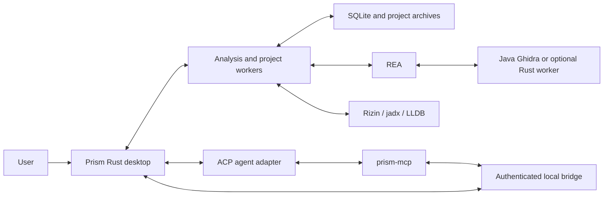

<p align="center">
  
</p>

# Prism

**A native reverse engineering workbench for understanding compiled software with analysis tools and AI agents.**

Prism brings a binary browser, code views, project annotations, persistent conversations, and source reconstruction into one desktop application. You can inspect a function yourself, ask an agent to investigate it, review the evidence, and keep the resulting notes and generated work with the project.

The application is written in Rust with **eframe/egui and an OpenGL renderer**. Its desktop interface does not use Electron, an embedded browser, or a JavaScript UI runtime. Analysis engines and agent adapters run as separate processes when their capabilities are needed.

**Status:** early development, version `0.1.0`. The repository contains working implementations alongside experimental integrations. A feature being present in the source does not mean every provider, platform, or target has passed end-to-end acceptance testing. macOS is the primary development platform; Windows and Linux support and packaging need further validation.

[Getting started](#getting-started) · [What it is](#what-prism-is) · [What it is not](#what-prism-is-not) · [Architecture](#architecture) · [Documentation](#documentation) · [MIT license](LICENSE)

## What Prism is

### A workspace for investigation

Prism keeps the target, its analysis, and the conversation together. Its workbench includes function inventories, assembly and pseudocode, control-flow and reference views, strings, imports, segments, hex inspection, notes, and bookmarks. Two analysis panes can retain independent tabs, selections, and navigation histories.

The intended workflow is iterative: open a target, locate useful evidence, inspect it, ask a focused question, and record what was learned. Function renames and notes are local project annotations. File-offset patches are exported to a separate copy rather than written over the input binary.

### A desktop client for agents

Prism communicates with agents through the **Agent Client Protocol (ACP)**. An agent can explain code and use Prism's **Model Context Protocol (MCP)** tools to inspect the open project, navigate functions, annotate findings, and coordinate reconstruction. The conversation supports streaming replies, tool activity, plans, attachments, model selection, and permission requests, subject to what the connected adapter advertises.

Agents are separately installed or launched adapters. Their authentication, model availability, billing, and tool capabilities belong to those providers. A normal command-line chatbot is not automatically an ACP server.

Bundled playbooks cover first-look surveys, function explanations, behavior searches, renaming, feature tracing, network mapping, decompilation, reconstruction, and shader inspection. Optional skill libraries can be imported separately.

### A coordinator for established analysis engines

The default native-analysis route is **Java Ghidra through REA**. Prism owns the UI, project state, local storage, and request coordination; the selected provider performs the underlying analysis.

Additional routes include Rizin, jadx for Android source, and optional REA integrations for other installed tools. An experimental Rust Ghidra worker can be enabled explicitly. Available formats, decompiler quality, function discovery, and reference completeness depend on the selected engine.

### A place to reconstruct and check candidate source

Reconstruction is a separate, explicit workflow. It uses indexed functions and recorded evidence to organize candidate source into modules, track shared interfaces and dependencies, and retain generations of work.

Prism supports bounded batch claims, evidence retrieval, source submissions, pause/resume, generation reuse, revision-specific build snapshots, and reports. Generated work is associated with its input hash and analysis identity. Build commands use installed language toolchains.

The output is a proposed implementation for review. Decompiled text, generated source, compiler success, and verified behavior are different kinds of evidence, and Prism keeps those distinctions visible.

## What Prism is not

- **Not a new universal decompiler.** Prism integrates analysis engines. It cannot recover information that the input and selected engine do not expose.
- **Not an exact source recovery machine.** Compilation can remove names, comments, types, source boundaries, and build information. A reconstruction can be plausible or compile successfully while behaving differently from the original program.
- **Not a complete replacement for every established reverse engineering suite.** Advanced processor support, dynamic analysis, platform-specific metadata, debugger behavior, and specialist workflows remain dependent on external tools or unfinished integrations.
- **Not an entirely Rust analysis stack.** The UI and MCP helper are Rust, but the default route uses REA, Node.js, Java, and Ghidra. The optional Rust worker still uses REA's runtime.
- **Not an AI model or hosted AI service.** Prism connects to agents. Installing it does not supply model access, subscriptions, or credentials.
- **Not automatically offline or a security sandbox.** Project storage is local, but agents, registries, downloads, and configured tools can use the network. Data sent to an agent follows that agent's behavior and provider policies. Permission handling does not isolate arbitrary external processes.
- **Not a packet capture tool or browser engine.** Web and network investigation currently depend on agent tools, supplied artifacts, and playbooks.
- **Not a finished GPU profiler or model debugger.** Current readers cover selected shader/source text and model metadata; full profiling and tensor inspection are outside the implemented scope.
- **Not a promise of a fixed memory limit or universal speedup.** Paging, bounded queues, and caches constrain particular workloads. External engines and agents have their own resource use. Historical benchmarks apply to their recorded machines, inputs, and builds.
- **Not a production release guarantee.** Successful compilation is one check. Live engine sessions, platform packaging, signing, and behavior on real targets require separate validation.

## Current capabilities and boundaries

| Area | Implemented | Important limits |
| --- | --- | --- |
| Desktop workspace | Native window, themes, settings, keyboard commands, split analysis panes, preview and retained tabs | Platform rendering differs; Linux and Windows need broader acceptance testing |
| Native analysis | Ghidra through REA, Rizin adapter, saved function inventories, bounded decompilation jobs, cached views | Requires compatible external tools; indirect references and discovery may be incomplete |
| Project browser | Paged function trees, grouping and filters, imports, segments, macOS app resources | Specialized resource previews and Android resource browsing are incomplete |
| Conversations | ACP sessions, streamed Markdown, tool activity, project chats, attachments, queued prompts, advertised model controls | Adapter capabilities vary; presence in the registry does not establish working authentication |
| Local projects | `.prism` archives, binary integrity checks, annotations, chat history, SQLite storage | This standalone format and profile replace earlier development identities; no automatic old-profile conversion is provided |
| Patches and comparison | File-offset patch export to a copy, changed-block comparison | No general function-matching binary diff or automatic patch-correctness proof |
| Android | jadx method inventory and Java source integration | Split packages, SMALI, JNI, and resource workflows are incomplete; live coverage is limited |
| Debugging | LLDB DAP launch/attach, breakpoints, stepping, threads, stack, evaluation commands | End-to-end sessions and stopped-event presentation still need validation |
| Reconstruction | Persistent generations, dependency and interface tracking, batch work, evidence, source snapshots, builds, reports | No automatic behavioral equivalence proof or guaranteed complete resource recovery |
| Models and shaders | Selected GGUF/safetensors metadata and shader/source text readers | No full GPU recording pipeline or comprehensive tensor inspection |
| Export | Text, assembly/pseudocode, bulk pseudocode, projects, patched copies, window capture | Provider-specific exports require a working provider; PDF and richer graph exports are incomplete |

## Getting started

### Build the desktop application

Install Rust through rustup and your platform's native build tools. The repository pins **Rust 1.93.1** and includes `Cargo.lock`. Native windowing dependencies are platform-specific; Linux builds may need additional development packages for the windowing and dialog backends.

```sh
git clone https://github.com/nanashili/prism.git
cd prism
cargo build --release --locked --bins
cargo run --release --locked
```

To open a target at startup:

```sh
cargo run --release --locked -- /absolute/path/to/target
```

The required artwork, fonts, and playbooks are included in this repository. A separate parent source checkout is not required. Building Prism does not install its external engines or agents.

### Configure analysis

In **Settings > Engines**, configure the tools for the route you want to use:

| Route | External requirements |
| --- | --- |
| Ghidra, the default | A compatible REA installation and Node runtime, Java home, and a Ghidra installation |
| Rizin | Rizin; pseudocode also needs a compatible decompiler plugin |
| Android | jadx |
| Experimental Rust Ghidra | A compatible REA build, Node, and REA's separately built Rust worker |
| Optional IDA or Hopper integration | REA support plus the corresponding installed application and any required license |
| Debugger | LLDB DAP |

No analysis engine is downloaded automatically. The Java route is compiled with the default `prism-ghidra-rea` feature. See [provider setup](docs/REFERENCE_BACKEND_PARITY.md) for the detailed integration notes.

To compile the optional Rust route alongside the default provider:

```sh
cargo build --release --locked --features rea-rust-ghidra --bin prism
```

Then select **Ghidra (Rust through REA)** in Engine settings. This route is experimental and is not the full Java Ghidra project service. See [Rust provider setup and limits](docs/REA_RUST_PROVIDER.md).

### Configure an agent

Choose an ACP adapter in Agent settings, authenticate through that adapter, and select one of its advertised models. The Codex preset uses `codex-acp` when installed or invokes `npx --yes @agentclientprotocol/codex-acp`, which can download the adapter and requires Node/npm.

Prism supplies its window and analysis MCP tools to connected agents. Review the configured permissions and use an initial read-only investigation to confirm the adapter and engine are working together.

## MCP integration

`prism-mcp` is a separate Rust stdio helper. It connects to Prism's authenticated loopback bridge and reuses the application's current project and analysis worker. It does not start another desktop window or its own decompiler.

It can be built independently of desktop dependencies:

```sh
cargo build --release --locked --no-default-features --bin prism-mcp
```

Example external client configuration, using the actual executable path from your build:

```json
{
  "mcpServers": {
    "prism": {
      "command": "/absolute/path/to/prism/target/release/prism-mcp",
      "args": []
    }
  }
}
```

Cargo's target directory can be overridden locally, so adjust that path if needed. The helper supports `--window` and `--analysis` modes. Initialization and tool discovery can run without a window; project operations need a running Prism session with an open target. Use the advertised tool schemas rather than assuming every external engine's API is exposed directly.

Tools include project opening and state, function navigation, local annotations, function inventories, bounded byte reads, analysis discovery, durable decompilation, and reconstruction. Tokens are kept out of client command lines. The bridge is a local integration boundary, not a sandbox for independent MCP clients or agents.

## Architecture



The UI uses event-driven rendering. Blocking analysis, indexing, storage, and process work are coordinated through dedicated workers and bounded channels. Function and resource lists are paged; code views and decompilation artifacts use bounded caches. These choices aim to keep large investigations responsive without loading every result into the visible UI.

| Path | Responsibility |
| --- | --- |
| `src/ui/` | Native presentation, panes, chat, settings, commands, and playbooks |
| `src/worker/` | Background operation scheduling, analysis, indexing, and exports |
| `src/analysis/` | Analysis-provider adapters and format readers |
| `src/agent/` | ACP sessions, streamed events, model options, and permissions |
| `src/mcp/`, `src/bridge/` | Stdio MCP tools and authenticated local app integration |
| `src/storage/`, `src/project/` | SQLite, caches, project archives, annotations, and patch export |
| `src/decompilation/` | Durable decompilation jobs and provider identities |
| `src/reconstruction/` | Generations, evidence, source objects, dependencies, builds, and reports |
| `src/debug/`, `src/protocol/` | Debugger integration and bounded subprocess transport |
| `skills/` | Bundled investigation playbooks |
| `resources/`, `notices/`, `vendor/` | Artwork, fonts, platform resources, dependency notices, and vendored sources |
| `scripts/`, `docs/` | Packaging and engineering documentation |

## Storage and compatibility

Prism stores its profile in the platform's local data directory under `Prism`. `PRISM_SUPPORT` overrides the location. The profile includes `prism.db`, `prism.views.db`, settings, project history, and caches. Source reconstruction maintains separate `.prism-reconstruction` state within its output directory.

Optional executable overrides include `PRISM_REA`, `PRISM_JADX`, `PRISM_LLDB_DAP`, and `REA_RIZIN_COMMAND`. Engine settings provide more detailed runtime configuration.

New project archives use the `.prism` extension and a Prism-specific header. Earlier development profiles and differently branded archives are not automatically migrated or overwritten. Renaming an old archive's extension alone does not convert its contents. Keep the original files until a deliberate conversion has been verified.

Attachments generally refer to their original paths rather than being archived into the chat. Moving or removing those inputs can make them unavailable to an agent later. Selected supported images can be embedded within the adapter's negotiated limits.

## Packaging and development

The macOS bundler builds both executables, includes resources and license notices, and ad-hoc signs the app:

```sh
python3 scripts/bundle-macos.py
```

The default output is `build/Prism.app`, with bundle identity `io.github.nanashili.prism`. Ad-hoc signing is for local use and does not provide notarization. External analysis tools remain separate in the default bundle. Optional Rust-provider packaging requires explicit runtime inputs, described in the [provider guide](docs/REA_RUST_PROVIDER.md).

Useful source checks:

```sh
cargo fmt --all -- --check
cargo check --locked --all-targets
cargo test --locked -- --test-threads=1
cargo clippy --locked --all-targets -- -D warnings
cargo check --locked --no-default-features --bin prism-mcp
```

Keep provider-dependent verification separate from deterministic tests. Report the target format, engine version, operating system, reproduction steps, and actual observed behavior when filing an issue. For code changes, preserve clear ownership, bounded work, explicit errors, and recoverable storage operations.

## Documentation

- [Decompilation jobs](docs/DECOMPILATION.md)
- [Generational source reconstruction](docs/RECONSTRUCTION.md)
- [Rust Ghidra provider](docs/REA_RUST_PROVIDER.md)
- [Performance roadmap](docs/PERFORMANCE_ROADMAP.md)
- [Resource-efficiency research](docs/RESOURCE_EFFICIENCY_RESEARCH.md)
- [Rust review and measured limitations](docs/RUST_REVIEW.md)
- [Accumulated implementation notes](docs/IMPLEMENTATION_NOTES.md)

Engineering reports retain historical measurements and reference-application comparisons. They are development evidence, not blanket performance claims or a substitute for the current setup instructions.

## License and attribution

Prism's original contributions and modifications are released under the [MIT license](LICENSE). Inherited material, vendored code, fonts, and integration artwork retain their applicable licenses and notices. See [NOTICE](NOTICE) and [THIRD_PARTY.md](THIRD_PARTY.md) for provenance and redistribution details.

External engines, agents, and model services have their own licenses and terms. Their names and logos identify integrations and do not imply endorsement.
