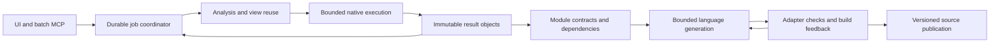

# Prism performance research and implementation roadmap

> Backend snapshot notice, 2026-10-20: macOS and Linux desktop builds now
> select Rust Ghidra through REA by default. Java Ghidra remains available in
> builds that enable `prism-ghidra-rea`. The older Prism-hosted `native_ghidra`
> worker remains removed. See
> [current provider setup and limits](REA_RUST_PROVIDER.md).
> Historical source inventories and measurements below remain unchanged and
> do not validate the current sources.

Research date: 2026-10-19. Five research agents inspected Prism, the original
Reference/REA implementation, and primary documentation and papers. The coordinator
reviewed their findings against the current code and corrected cache, ownership,
complexity, and measurement claims before synthesis. This is a proposed roadmap,
not a claim that every capability has shipped.

## Current implementation status

The first roadmap slice is implemented: saved native analysis restores use
bounded range blocks, durable decompilation jobs freeze inventory and commit a
per-function cursor with compressed artifacts, and reconstruction generations
persist module dependencies, SCCs and bounded ready contracts. Generation
identity includes analyzer, model, prompt, adapter and validation versions.
Validation remains language-specific and `behavior_verified` remains false.

The RAM follow-up replaces the restore XML DOM with bounded source-range indexes,
shares executable bytes and symbol-name ranges, and keeps compact live function
handles. On the same large checkpoint, peak restore RSS fell from 868.75 to
543.56 MiB and retained worker physical footprint after inventory from 476.1 to
410.4 MiB; restoration remained about three seconds. These are native-worker
measurements, not a whole-app or full-job memory ceiling. See the
[measurement conditions and limits](RUST_REVIEW.md#analysis-worker-ram-reduction).

The final 2026-10-19 profile refines those historical measurements. Saved Unity
metadata restore physical footprint fell from 411.0 to 289.4 MiB, while restore
time moved from 2.558 to 2.631 seconds; no Unity code was analyzed. A 1,024-
address durable Prism batch completed 1,023 and failed one in 150.737 to
151.654 seconds (approximately +0.6%). All 1,024 durable result payloads were
byte-identical, including the known 1,024 MiB RSS-budget failure at
`0x10002e8b4`. The production reconstruction profile processed 256 evidence
items over 64 pages, persisted 3,499,891 existing source bytes and retried
idempotently; 249 evidence results succeeded and seven addresses were outside
executable sections. Native reconstruction lifetime peak fell from 83.03 to
62.86 MiB, and evidence time from 1.90 to 1.56 seconds. No AI generation or
build ran, and this profile does not establish a 200,000-function result or a
global RAM ceiling. See [the complete profile](BATCH_MEMORY_PROFILE.md).

RSS and physical footprint are separate accounting views, especially with the
read-only, privately owned file-backed image mapping. The host samples were
always taken after headless support because the old comparison binary lacked
headless mode, so no comparative host-memory claim is valid; the current host
footprint was about 34 MiB. The original Arena remains in production after a
paged and dense alternatives were approximately 8–9% slower. Final Rust checks, the existing application test and signed macOS packaging
passed; the vendor test fixture remains missing. See the profile for exact
commands, verification gaps and platform limits.

The durable job is intentionally one project-wide worker. New jobs may
auto-activate; existing jobs survive normal restarts through SQLite artifacts
but require an explicit `resume`. It does not silently restart existing native
work. Foreground analysis yields between functions, while project/configuration
changes pause it. The remaining roadmap covers independent checkpoint sections,
resource accounting, language adapter breadth and measured model throughput. No
tenfold speedup, one-hour whole-binary export or instant native restore is
established by the current measurements.

## Decision and historical design context

The original research decision was to make expensive work reusable and
independently resumable: a durable batch export, compact persisted indexes, and
incremental module reconstruction. The first slice now implements those
boundaries while retaining one native analysis worker. Parallel native contexts
remain conditional on measured memory and throughput.

The historical baseline below predates the durable job and reconstruction
dependency work. Remaining gaps are independent checkpoint sections, external
provider-version identity, broader language adapters and measured throughput;
they are not reasons to add another general cache or blindly increase worker
count.

“Any language” should mean an explicit language adapter with a stated ABI,
runtime, build and validation contract. Reuse analysis across adapters, but
report which behavior each adapter can preserve. Neither the papers nor this
worktree establish universal source recovery or a tenfold speedup.

## Evidence from the current system

| Finding | Evidence | Implication |
| --- | --- | --- |
| Batch requests accept 64 addresses but execute sequentially and return at most four results | [Batch implementation](../src/worker/decompile_batch.rs) | 200,000 results require at least 50,000 current replies; a backend job removes model coordination between pages |
| Native views already survive restarts in an evictable cache | [Native cache owner](../src/worker/analysis_cache.rs), [view routing](../src/worker/analysis.rs) | Seed durable export from it; do not duplicate cache behavior |
| Native restore parses saved JSON/XML and rebuilds symbol indexes | Checkpoint, [snapshot restore](../vendor/ghidra-decompiler/src/program/snapshot.rs) | Persisting state avoids reanalysis but does not make restoration constant-time |
| Historical pre-range-block restore took 18.536 s, peaking at 1,062 MiB RSS | [Restore measurement and limits](RUST_REVIEW.md#saved-analysis-restore-range-traversal) | Keep this baseline labelled historical; it is not an instant-reopen result |
| The bounded range index restored the copied checkpoint in 2.83–3.37 s, peaking near 892 MiB RSS | [Implementation measurement and limits](RUST_REVIEW.md#durable-decompilation-and-modular-reconstruction) | Native readiness is substantially faster; decoded-state memory and first-query costs remain separate work |
| A checkpoint has an exclusive per-image lock and each native session owns a mutable Program | Checkpoint, session | Starting identical workers against one checkpoint is not a valid concurrency design |
| Reconstruction already has generations, leases, immutable objects and build receipts | [Current reconstruction contract](RECONSTRUCTION.md) | Extend these owners rather than building a second reconstruction engine |
| Historical queueing used module/address order without dependency readiness | [Queue](../src/reconstruction/queue.rs) | The implemented dependency/SCC graph now gates ready work; broader throughput remains to be measured |

The original Reference app also reads cached results before opening Ghidra. Its
REA backend imports a packed Ghidra database with analysis disabled. Prism's
Rust snapshot instead rebuilds its in-memory representation. That difference
explains a useful design direction, but no matching Reference restore timing was
measured. See the [source comparison](ANALYSIS_RESTORE_RESEARCH.md).

## Proposed architecture

The UI reads compact status and selected artifacts. It does not need to transport
every function body through a conversation. Plain decompilation ends at durable
pseudocode export; reconstruction consumes those outputs in its separate workflow.
Both remain behind the required batch MCP commands.

Use a small manifest and immutable objects as the common storage boundary.
Separate an **action digest** identifying inputs/options from an **output digest**
identifying bytes. An output becomes complete only after its bytes and reference
are durable. Preserve the existing single publication owner, cancellation,
lease expiry, explicit errors and conflict checks.

## Implementation order

### 1. Remove avoidable restore work (partially implemented)

Owner: existing native checkpoint and vendor snapshot/index modules.

The bounded property-range traversal and private range-block container are
implemented. Each block holds at most 1,024 entries; splitting before insertion
bounds local moves and avoids temporary capacity growth. A cumulative rank
directory preserves indexed range operations and adds work proportional to the
number of blocks when edited. The checkpoint format and identity are unchanged.
This is not bulk loading: restoration still performs live symbol/range queries.
Fresh-worker measurements with the copied checkpoint took 2.83–3.37 seconds and
peaked near 892 MiB RSS. Filesystem caches were not forced cold, and the earlier
18.608-second baseline used an optimized profiling build with symbols retained.

For the durable design, store versioned, indexed sections that can be loaded
independently. Validate offsets, lengths, identity and checksums; retain the
old checkpoint until the new generation is fully published. Memory mapping is
a later adapter decision with explicit lifetime and mutation rules, not a
shortcut around validation. The Java packed database is a design precedent,
not a format the current Rust wrapper can simply consume.

Acceptance: report checkpoint decode, native initialization, index restoration,
first uncached function and cached-view latency separately. Preserve saved
identity and range semantics. Proposed responsiveness target: cached navigation
p95 below 100 ms on a declared reference machine; this is not currently a
measured whole-app guarantee. Cold native readiness has a separate budget.

### 2. Durable export behind batch MCP (implemented first slice)

Owner: a focused `src/decompilation/` module for manifests, jobs and artifacts;
thin routing remains in `src/worker/decompile_batch.rs` and the MCP catalog.
Reuse existing SQLite, hashing, compression and atomic file primitives.

The durable job now starts or resumes an export identified by its frozen native
inventory, configured options and native cache identity. The backend owns
iteration, progress, bounded result pages and cancellation. It returns a job
identifier and summaries while retaining small interactive pages. Results stay
in the database; automatic filesystem artifact export is not part of this job.

Persist per-function success, timeout, blocker and retry state. Publish each
artifact before advancing completion. Existing jobs require explicit resume
after restart; new jobs may auto-activate. `retry_failed` rewinds to the
earliest failure, pauses and retains successes. Seed hits from the
configuration-scoped view cache; cache eviction must not erase export completion.
Strict decompilation and reconstruction reads also reuse checksum-verified
durable artifacts and exclude legacy upstream fallback entries. Keep output
grouped by modules.

Acceptance: completion survives restart, already committed functions do not run
again, counts reconcile, and polling traffic stays independent of total function
count. Bound both queue bytes and items. A larger response page alone is not
this capability.

### 3. Make reconstruction incremental by module (implemented first slice)

Owner: existing `src/reconstruction/` generation, evidence, queue, object,
submission and build modules; add focused contract/dependency owners as needed.

Persist compact language-independent records for known ABI, types, data effects,
calls and uncertainty. Avoid embedding a second general compiler framework.
The generation now persists shared contracts, dependency edges and strongly
connected components, and releases implementation work only when dependencies
are ready. Apply priority heuristics only among ready modules. Very large
recursive groups still need explicit limits and interface-based partitions, not
oversized prompts.

Extend fingerprints by stage: input/analyzer changes invalidate analysis and
dependents; model/prompt changes invalidate generation and its validation;
compiler/validator changes invalidate validation only. Dependency-summary
changes invalidate affected consumers. Retain source/object reuse when bytes
remain valid. This follows the compact-summary and incremental-cache approach
documented by [LLVM ThinLTO](https://clang.llvm.org/docs/ThinLTO.html), adapted
to Prism's different correctness requirements.

Acceptance: changing one module or language reuses unaffected analysis; changing
the compiler does not redecompile the original binary. Record cache misses and
their reasons. Generated, checked, built and behavior-validated remain distinct
states, with existing receipts supporting bounded repair.

### 4. Govern memory before increasing concurrency

Owner: worker lifecycle and native architecture/image ownership; reconstruction
queue and object readers keep their own narrow budgets.

Separate immutable input/index ownership from mutable per-function state.
`Arc` can share data within one process; separate processes need a suitable
read-only mapping or independent copies. The current mutable Program boundary
does not yet permit lightweight isolated contexts. Keep a single native worker
until that constraint and checkpoint ownership are resolved.

Budget GUI, coordinator, workers, queues and temporary build memory together.
Worker admission needs measured peak headroom, not only a count derived from CPU
cores. Stop admitting work under pressure; release idle workers only after safe
checkpoint/teardown. Repeatedly evicting an active worker would trade RAM for
expensive restore thrashing.

Use item and byte bounds, short transactions and streaming artifact export.
The current checkpoint reader already streams compressed JSON, so allocating a
new streaming wrapper alone will not remove its owned XML/DOM/native-map cost.
Treat SQLite cache sizing as a target, not a process RSS ceiling. Reconstruction
already uses WAL; preserve short transactions because SQLite still has one
writer. [SQLite WAL documentation](https://www.sqlite.org/wal.html)

Acceptance: report process-family RSS plus platform footprint where available,
page faults, queue peaks and total CPU. Shared mappings can be counted more than
once by summed RSS, so document accounting. Compare 1/2/4 workers only after
ownership is correct; choose the fastest configuration within the declared budget.

### 5. Add language adapters and measured model throughput

Owner: existing reconstruction build commands plus narrow adapter definitions.

Start with supported toolchains and explicit ABI/runtime limitations. A text
language field and a successful `cargo check`, `tsc --noEmit` or Python syntax
check do not establish a runnable reconstructed program. Use bounded compiler
diagnostics for repair and existing permitted execution evidence when available.
No new tests, fixtures or harnesses are proposed under the current user constraint.

Batch independent modules, reuse stable prompt prefixes where the provider
supports it, and cap model concurrency separately from CPU workers. Provider
batch services can reduce cost but their completion windows do not establish an
interactive speedup. Keep the deployed application small by reusing external
toolchains/providers rather than bundling every compiler or a large local model.
See [language research](LANGUAGE_RECONSTRUCTION_RESEARCH.md) for primary sources
and the concrete adapter/validation design.

## Feasibility and reporting

200,000 successful unique decompilations in one hour requires **55.56 per
second**, including startup, persistence and retries. At an assumed 100 ms mean
native service time, eight ideal workers need 41 min 40 s before overhead. At
500 ms, even the ideal requirement is 28 workers. These are arithmetic examples,
not observations of Prism or predictions for Unity.

Reconstruction has additional model, integration and repair costs. A tenfold
parallel speedup with finite workers requires a serial fraction below 10%,
and reuse changes the amount of work rather than merely its parallelism.
Report these benefits separately. Do not compare a cold complete baseline to
a warm partial run. The [feasibility report](PERFORMANCE_FEASIBILITY_RESEARCH.md)
defines denominators, quality states and measurement gates.

For large RAM reductions, prioritize decoded state and ownership. For binary
size, first produce a feature/symbol breakdown; current release settings already
use stripping, thin LTO and size optimization with the decompiler at level 3.
Changing everything to size optimization can slow the hot path. No dependency,
feature removal, or universal RAM target is justified by these sources alone.

## Research records and provenance

Each agent wrote one note; the existing reconstruction research was preserved:

1. [Decompilation throughput](DECOMPILATION_THROUGHPUT_RESEARCH.md)
2. [Saved analysis and original Reference comparison](ANALYSIS_RESTORE_RESEARCH.md)
3. [Language reconstruction](LANGUAGE_RECONSTRUCTION_RESEARCH.md)
4. [Resource efficiency](RESOURCE_EFFICIENCY_RESEARCH.md)
5. [Independent feasibility](PERFORMANCE_FEASIBILITY_RESEARCH.md)

The parent repository is at `85a9be336ecf442cd8a8aa27a8a98060cee0646a`, but
`prism/` is untracked there, so that commit does not identify this implementation.
The vendor baseline is ghidra-decompiler 2.1.0 at
`268c3a406d8d964bc00ae2ead4d3e1e1373aaa27`, with documented local patches.
Selected SHA-256 fingerprints of the inspected worktree are:

| File | SHA-256 |
| --- | --- |
| `Cargo.lock` | `3617136e572feab41a6aa5b1ac029460c7e20007e974b5f782ea604690ca2ef6` |
| `src/worker/decompile_batch.rs` | `8709ba0816e866654239802298ea8318b39d2d82ec5ab268bd369a41e78d6deb` |
| `src/worker/analysis_cache.rs` | `b18399bf9bb9fb9ec6b60f1c1a52ca0d82eca42113759dccdbfb3b2c24eb8e82` |
| `src/analysis/native_ghidra/checkpoint.rs` | `0df8fa60266815bdde651721568c7ce49c023df1d4551687e5f7f4c6e67c0469` |
| `src/reconstruction/generation.rs` | `150bdd5e5e398595f0445dda06a7316c1871020364a95f337a0382a96dc3d75a` |
| `src/reconstruction/queue.rs` | `eacca036eb5745b54792e5604003641395402efe1942cdb912225b6488e9bce2` |

No proprietary function bodies were used for this research. No new tests,
fixtures, harnesses or dependencies were added. Proposed performance targets
remain unverified until implemented and measured under the stated conditions.
